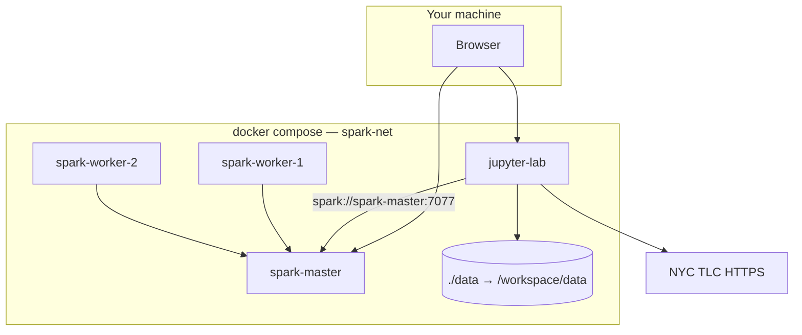

# Spark + Iceberg Lab

Hands-on PySpark on a **multi-node Spark cluster** in Docker. Jupyter Lab is the driver; **Apache Iceberg** is the default table format.

## Prerequisites

- **Docker** with the [Compose](https://docs.docker.com/compose/) plugin  
- **8 GB+ RAM** assigned to Docker (16 GB is more comfortable)

Java, Python, PySpark, Jupyter, and Iceberg are included in the cluster image. Host install details: [requirements/SETUP.md](requirements/SETUP.md).

## Stack (cluster image)

| Component | Version |
|-----------|---------|
| Spark / PySpark | 4.1.x |
| Iceberg | 1.12.0 (`iceberg-spark-runtime-4.1_2.13`) |
| Java | 17 |
| Jupyter | Lab 4.x |

## Quick start

From the repository root:

```bash
docker compose -f docker/docker-compose.yml up -d --build
```

Open **Jupyter Lab** at http://localhost:8888 (default host port for container `8888`).

Work through the modules in order (`01` → `06`). In each notebook, run the **first code cell** first—it calls `begin_module()`, which fetches NYC TLC data when needed and starts a Spark session.

```python
from shared.spark_session import begin_module, ui_links

spark = begin_module("module-01-spark-plans")
ui_links()
```

The **Spark application UI** is on host port **4040** while a session is active (after that first cell runs).

### Default ports

| Service | Default URL |
|---------|-------------|
| Jupyter Lab | http://localhost:8888 |
| Spark application UI | http://localhost:4040 |
| Spark master UI | http://localhost:8080 |
| Worker 1 / 2 UI | http://localhost:8081 , http://localhost:8082 |

To change ports, edit `ports:` in [docker/docker-compose.yml](docker/docker-compose.yml).

### Stop and reset

```bash
docker compose -f docker/docker-compose.yml down
```

Logs:

```bash
docker compose -f docker/docker-compose.yml logs -f
```

Remove local outputs and cached TLC files:

```bash
docker compose -f docker/docker-compose.yml down -v
rm -rf data/output data/cache
```

## Modules

| # | Topic | Directory |
|---|-------|-----------|
| 01 | Spark API parity & query plans | [01-spark-plans/](01-spark-plans/) |
| 02 | Optimizer rules & join strategies | [02-plan-joins/](02-plan-joins/) |
| 03 | Storage I/O, types, Iceberg | [03-storage-io/](03-storage-io/) |
| 04 | Lazy execution, cache, observation | [04-lazy-execution/](04-lazy-execution/) |
| 05 | Locality, shuffle, SPJ | [05-data-locality/](05-data-locality/) |
| 06 | UDF performance | [06-udfs/](06-udfs/) |

## Architecture



## Data

Trip Parquet files and zone lookup CSV are downloaded into `data/cache/` on first `begin_module()` (not committed to git). Iceberg warehouse and other writes go to `data/output/`. See [data/README.md](data/README.md).

## Troubleshooting

| Issue | What to try |
|-------|-------------|
| `:4040` not reachable | Run the first cell (`begin_module`); UI exists only while the driver is running |
| `Connection refused` to `spark-master:7077` | Wait for workers; `docker compose -f docker/docker-compose.yml logs -f` |
| OOM | Give Docker more RAM or lower memory in `docker/spark-defaults.conf` |
| TLC download fails | Re-run `begin_module`; delete a corrupt file under `data/cache/` |

More: [docker/README.md](docker/README.md).

## License

Apache License 2.0.