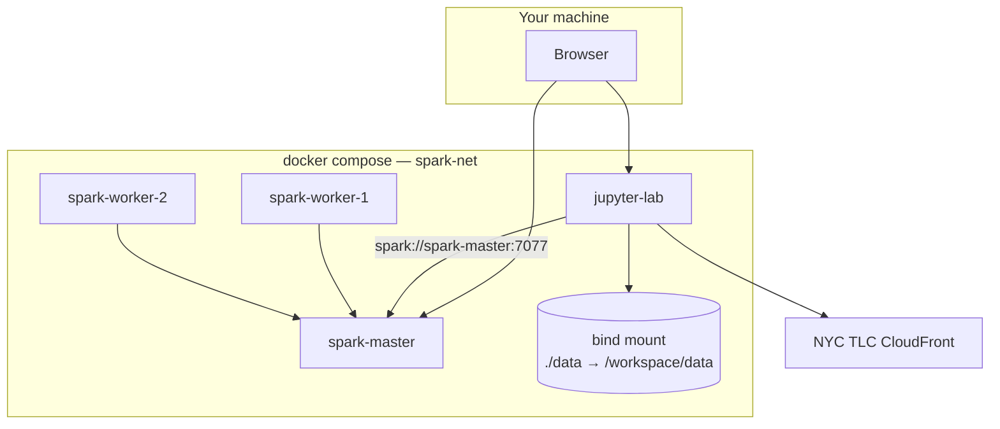

# Spark + Iceberg Lab

PySpark exercises on a **multi-node Spark cluster** in Docker, with Jupyter Lab as the driver and **Apache Iceberg** as the default table format.

## Prerequisites

**Docker** with the **Compose** plugin ([requirements/SETUP.md](requirements/SETUP.md)). That is the only host dependency.

Java 17, Python, PySpark, Jupyter, and Iceberg are in the cluster image (`docker/Dockerfile`). Allocate **8 GB+ RAM** to Docker (16 GB recommended).

## Stack (inside the image)

| Component | Version |
|-----------|---------|
| Spark / PySpark | 4.1.x |
| Iceberg | 1.12.0 (`iceberg-spark-runtime-4.1_2.13`) |
| Java | 17 |
| Jupyter | Lab 4.x |

## Run the cluster

From the **repository root**:

```bash
docker compose -f docker/docker-compose.yml up -d --build
```

Stop:

```bash
docker compose -f docker/docker-compose.yml down
```

Logs:

```bash
docker compose -f docker/docker-compose.yml logs -f
```

Reset local lab data (optional):

```bash
docker compose -f docker/docker-compose.yml down -v
rm -rf data/output data/cache
```

Open Jupyter at the **host port** mapped to container `8888` in `docker/docker-compose.yml` (default `8888` → http://localhost:8888). If you remap ports, use your chosen host ports for all UIs below.

GNU Make wraps the same compose commands (`make up`, `make down`, …) on macOS/Linux when Make is installed.

## Port map (default compose bindings)

Host ports are defined in `docker/docker-compose.yml`. Change the left-hand side of each `ports:` entry if something is already bound on your machine.

| Service | Container port | Default host port | Purpose |
|---------|----------------|-------------------|---------|
| jupyter-lab | 8888 | 8888 | Jupyter Lab |
| jupyter-lab | 4040 | 4040 | Spark application UI |
| spark-master | 8080 | 8080 | Master UI |
| spark-master | 7077 | 7077 | Spark RPC (cluster internal; usually no browser) |
| spark-worker-1 | 8081 | 8081 | Worker 1 UI |
| spark-worker-2 | 8082 | 8082 | Worker 2 UI |

`shared/config.py` exposes `MASTER_UI_URL` and `APP_UI_URL` for notebooks using these defaults; update them if you remap ports.

## Architecture



## Modules

| # | Topic | Directory |
|---|-------|-----------|
| 01 | Distributed execution, Spark UI, query plans | [01-how-spark-works/](01-how-spark-works/) |
| 02 | Lazy evaluation, actions, DAG branching, cache/checkpoint | [02-lazy-execution/](02-lazy-execution/) |
| 03 | Storage I/O — JSON, Parquet, Iceberg benchmarks | [03-storage-io/](03-storage-io/) |
| 04 | UDF cost — Python vs Pandas vs native Spark | [04-udfs/](04-udfs/) |
| 05 | Shuffle, joins, SPJ, Iceberg table ordering | [05-shuffle-sort/](05-shuffle-sort/) |
| 06 | JVM heap and GC in the Spark UI | [06-java-gc/](06-java-gc/) |

First cell in each notebook:

```python
from shared.spark_session import begin_module, ui_links

spark = begin_module("my-app-name")
ui_links()
```

`begin_module()` downloads missing TLC data into `data/cache/` on first run, then starts Spark.

## Data

TLC inputs are fetched at runtime (not in git). Warehouse output: `data/output/` ([data/README.md](data/README.md)).

## Troubleshooting

### Application UI unreachable

The app UI is only up while a Spark session runs. Run the first cell (`begin_module`) in the next notebook. Use the host port mapped to container `4040` (default 4040).

### `Connection refused` to `spark-master:7077`

Wait for workers: `docker compose -f docker/docker-compose.yml logs -f`.

### OOM

Tune `docker/spark-defaults.conf` or increase Docker memory.

### TLC download failures

Re-run `begin_module`. Delete a bad file under `data/cache/` and retry.

See [docker/README.md](docker/README.md).

## License

Apache License 2.0.
