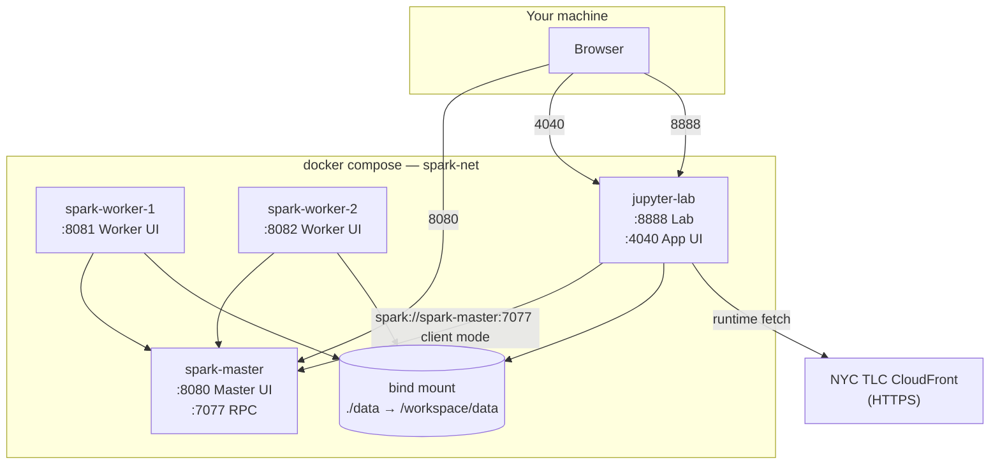

# Spark + Iceberg Lab

PySpark exercises on a **multi-node Spark cluster** in Docker, with Jupyter Lab as the driver and **Apache Iceberg** as the default table format.

## Prerequisites

Install **Docker Desktop** (macOS/Windows) or **Docker Engine + Compose plugin** (Linux). That is the only host dependency for running the lab.

Java 17, Python 3, PySpark, Jupyter Lab, and the Iceberg runtime JAR are baked into the image at build time (`docker/Dockerfile`, `requirements/requirements.txt`). Do not install Java or Python on the host unless you are developing the repo locally (see [requirements/SETUP.md](requirements/SETUP.md)).

Give Docker at least **8 GB RAM** (16 GB recommended).

## Stack (inside the image)

| Component | Version |
|-----------|---------|
| Spark / PySpark | 4.1.x |
| Iceberg | 1.12.0 (`iceberg-spark-runtime-4.1_2.13`) |
| Java | 17 |
| Jupyter | Lab 4.x |

Spark **4.1** ships with the published Iceberg 1.12 runtime JAR. The `iceberg-spark-runtime-4.2_2.13` artifact is not on Maven yet; the exercises (SPJ, vectorized reads, Catalyst plans, table ordering) apply the same on 4.1.

## Setup and run the cluster

### 1. Verify Docker (optional)

```bash
./requirements/setup-macos.sh    # or setup-linux.sh
```

```powershell
.\requirements\setup-windows.ps1
```

Install Docker first if the script fails: [requirements/SETUP.md](requirements/SETUP.md).

### 2. (Optional) Pre-download datasets

On slow networks, cache TLC files on the host (bind-mounted into containers):

```bash
./scripts/cache-data.sh          # macOS, Linux, Git Bash
```

```powershell
.\scripts\cache-data.ps1       # Windows
```

### 3. Start the cluster

```bash
./scripts/cluster-up.sh          # macOS / Linux
```

```powershell
.\scripts\cluster-up.ps1         # Windows
```

Equivalent command:

```bash
docker compose -f docker/docker-compose.yml build
docker compose -f docker/docker-compose.yml up -d
```

Open **http://localhost:8888** for Jupyter Lab.

### 4. Stop / reset

```bash
./scripts/cluster-down.sh        # stop containers
./scripts/cluster-clean.sh       # stop and remove data/cache + data/output
```

`cluster-up` builds the image (installs Python deps from `requirements/requirements.txt`) and starts containers. On macOS/Linux with GNU Make, `make up` / `make down` / etc. wrap the same scripts.

## Architecture



## Port map

| Service | URL | Purpose |
|---------|-----|---------|
| Jupyter Lab | http://localhost:8888 | Notebooks |
| Spark Master UI | http://localhost:8080 | Cluster overview |
| Spark Worker 1 UI | http://localhost:8081 | Worker metrics |
| Spark Worker 2 UI | http://localhost:8082 | Worker metrics |
| Spark Application UI | http://localhost:4040 | Jobs, stages, tasks (per driver session) |

## Modules

| # | Topic | Directory |
|---|-------|-----------|
| 01 | Distributed execution, Spark UI, query plans | [01-how-spark-works/](01-how-spark-works/) |
| 02 | Lazy evaluation, actions, DAG branching, cache/checkpoint | [02-lazy-execution/](02-lazy-execution/) |
| 03 | Storage I/O — JSON, Parquet, Iceberg benchmarks | [03-storage-io/](03-storage-io/) |
| 04 | UDF cost — Python vs Pandas vs native Spark | [04-udfs/](04-udfs/) |
| 05 | Shuffle, joins, SPJ, Iceberg table ordering | [05-shuffle-sort/](05-shuffle-sort/) |
| 06 | JVM heap and GC in the Spark UI | [06-java-gc/](06-java-gc/) |

Each module notebook starts with:

```python
from shared.spark_session import begin_module, ui_links

spark = begin_module("my-app-name")
ui_links()
```

Call `begin_module()` in the **first cell** when switching notebooks so the driver binds to port 4040 and prior sessions are stopped.

## Data

Inputs are NYC TLC public datasets (not stored in git):

- Yellow taxi: `https://d37ci6vzurychx.cloudfront.net/trip-data/yellow_tripdata_2024-01.parquet`
- Zone lookup: `https://d37ci6vzurychx.cloudfront.net/misc/taxi_zone_lookup.csv`

Iceberg warehouse and checkpoints: `data/output/` (gitignored). See [data/README.md](data/README.md).

## Troubleshooting

### Application UI missing at :4040

The UI exists only while a Spark session is active. After kernel shutdown, open the next notebook and run the first cell (`begin_module`).

### `Connection refused` to `spark-master:7077`

Wait for startup: `./scripts/cluster-logs.sh` or `docker compose -f docker/docker-compose.yml logs -f`.

### OOM

Lower executor memory in `docker/spark-defaults.conf` or give Docker more RAM.

### TLC download failures

Run `scripts/cache-data.sh` or `scripts/cache-data.ps1`, then restart the cluster.

More: [docker/README.md](docker/README.md).

## License

Apache License 2.0.
