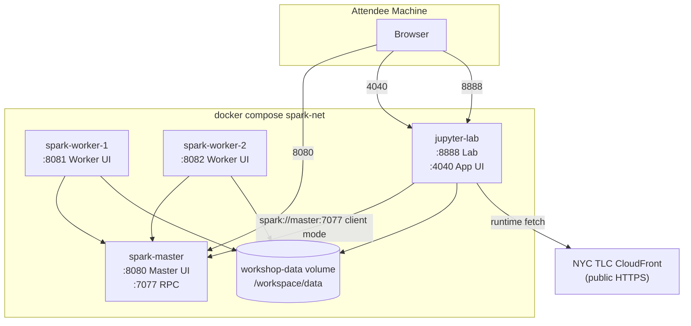

# Spark Workshop

A hands-on, 6-hour workshop repository for deep conceptual understanding of Apache Spark with modern best practices. Attendees run PySpark jobs locally in a Docker-based multi-node cluster with Jupyter Lab and Apache Iceberg.

## Stack

| Component | Version |
|-----------|---------|
| Spark / PySpark | 4.1.x |
| Iceberg | 1.12.0 (`iceberg-spark-runtime-4.1_2.13`) |
| Java | 17 (21 also supported) |
| Python | 3.10+ |
| Jupyter | Lab 4.x |

> **Why Spark 4.1 instead of 4.2?** As of Iceberg 1.12.0, the `iceberg-spark-runtime-4.2_2.13` JAR is not yet published to Maven. Spark 4.1 + Iceberg 1.12.0 is the stable combination for this Iceberg-focused workshop. All concepts (SPJ, vectorized reads, Catalyst plans, table ordering) apply identically.

## Prerequisites

- Docker Desktop or Docker Engine (8 GB RAM minimum recommended)
- Java 17+ (for local-mode fallback)
- Python 3.10+ (for local-mode fallback)

See [requirements/SETUP.md](requirements/SETUP.md) for per-OS installation steps.

## Quick Start

```bash
# 1. Install Python dependencies (optional for Docker-only workflow)
make setup

# 2. (Optional) Pre-download datasets for slow/offline networks
make cache-data

# 3. Start the cluster
make up

# 4. Open Jupyter Lab
open http://localhost:8888
```

Each module has a single instructor-led notebook. Every notebook starts with:

```python
from shared.spark_session import get_spark
spark = get_spark("my-app-name")
```

## Architecture



## Port Map

| Service | URL | Purpose |
|---------|-----|---------|
| Jupyter Lab | http://localhost:8888 | Notebooks |
| Spark Master UI | http://localhost:8080 | Cluster overview |
| Spark Worker 1 UI | http://localhost:8081 | Worker metrics |
| Spark Worker 2 UI | http://localhost:8082 | Worker metrics |
| Spark Application UI | http://localhost:4040 | Per-session job/stage/task view |

## Workshop Agenda (~6 hours)

| Module | Topic | Directory |
|--------|-------|-----------|
| 01 | How Spark works — distributed computing, Spark UI, query planner | [01-how-spark-works/](01-how-spark-works/) |
| 02 | Lazy execution — actions, DAG branching, cache/checkpoint | [02-lazy-execution/](02-lazy-execution/) |
| 03 | Storage I/O — JSON/Parquet/Iceberg read & write performance | [03-storage-io/](03-storage-io/) |
| 04 | UDF performance — Python vs Pandas vs native Spark | [04-udfs/](04-udfs/) |
| 05 | Shuffle & sort — join strategies, SPJ, table ordering | [05-shuffle-sort/](05-shuffle-sort/) |
| 06 | Java GC tuning + optional Gluten demo | [06-java-gc-gluten/](06-java-gc-gluten/) |

## Data Sources

Input data is fetched at runtime from public NYC TLC datasets (no large files in git):

- Yellow taxi trips: `https://d37ci6vzurychx.cloudfront.net/trip-data/yellow_tripdata_2024-01.parquet`
- Taxi zone lookup: `https://d37ci6vzurychx.cloudfront.net/misc/taxi_zone_lookup.csv`

All workshop outputs are written to `data/output/` (Docker volume, gitignored).

See [data/README.md](data/README.md) for details.

## Run Modes

### Recommended: Docker cluster

```bash
make up
```

Notebooks connect to `spark://spark-master:7077` automatically.

### Fallback: Local mode (no Docker)

```bash
source .venv/bin/activate
export SPARK_MASTER='local[*]'
export JAVA_HOME=$(/usr/libexec/java_home -v 17)  # macOS example
jupyter lab
```

Outputs go to `./data/output/`.

## Makefile Commands

| Command | Description |
|---------|-------------|
| `make setup` | Create venv and install Python deps |
| `make build` | Build Docker images |
| `make up` | Start cluster |
| `make down` | Stop cluster |
| `make logs` | Follow container logs |
| `make cache-data` | Pre-download TLC datasets |
| `make up-gluten` | Start optional Gluten profile (module 06) |
| `make clean` | Stop cluster and remove volumes |

## Troubleshooting

### Spark Application UI not accessible at :4040

The App UI only exists while a Spark session is running. When you **shut down a kernel**, the driver stops and `:4040` goes away — that is expected.

To start a new session in the next module:

1. Open the new module notebook
2. Run the first cell — it calls `begin_module(...)` which starts a fresh session
3. Open http://localhost:4040

If `:4040` is still unreachable after running the first cell, restart the kernel and run the first cell again. Avoid using "Shut Down Kernel" without running `stop_spark()` first — `begin_module()` handles cleanup automatically.

### Connection refused to spark-master:7077

Wait for the cluster to finish starting (`make logs`). Ensure all containers are on the `spark-net` network.

### Out of memory errors

Reduce executor memory in `docker/spark-defaults.conf` or close other applications. Minimum 8 GB host RAM recommended.

### Network errors reading TLC data

Run `make cache-data` and restart the cluster. Cached files are read from `/workspace/data/cache/`.

See [docker/README.md](docker/README.md) for more Docker-specific troubleshooting.

## License

Apache License 2.0 — workshop materials are free to use and adapt for educational purposes.
